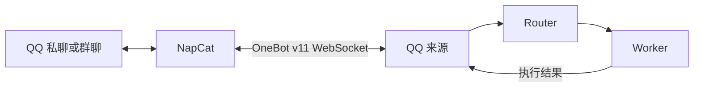

# 通过 NapCat 接入 QQ

NapCat 负责 QQ 登录和 OneBot v11，Superagent 负责消息路由、任务执行及回复。

本维护部署已于2026-11-02迁入CNB：NapCat与Superagent同环境运行，数据位于`/workspace/.superagent-runtime/data/napcat`，每5分钟随私有快照上传武汉。当前QQ授权用户为`1791081637`，群列表为空。本机便携包保留作回退副本；切换前先停旧端，保持同账号单端运行。详见[迁移实录](cnb-napcat-migration-record.md)。



## 1. 启动 NapCat 并登录

按 [NapCat 官方安装文档](https://napneko.github.io/guide/boot/Shell) 安装对应系统版本，启动后扫码登录机器人使用的 QQ 账号，并确认在线。

当前本机维护环境已准备官方 `v4.18.42` Shell 便携包及手动启动脚本：

```powershell
& 'E:\VSCODE-project\SuperAgent\napcat\Start-NapCat.ps1'
```

包的 SHA-256 已与官方 GitHub Release 一致性校验。准备过程仅下载、解压和检查启动文件，账号登录与真实 QQ 通信留待操作者完成。其他安装位置可直接使用官方 `launcher-user.bat`。

## 2. 选择连接方式

在 Superagent 的 **设置 → 来源 → QQ · NapCat** 中选择方式。

| Superagent 选项 | NapCat 中开启 | 连接方向 | 默认地址 |
| --- | --- | --- | --- |
| 正向 WebSocket | WebSocket **服务端** | Superagent 主动连接 NapCat | `ws://127.0.0.1:3001` |
| 反向 WebSocket | WebSocket **客户端** | NapCat 主动连接 Superagent | `ws://127.0.0.1:6199/onebot/v11/ws` |

两种方式选择一种即可。

### 正向模式

1. 在 NapCat WebUI 的 OneBot v11 网络配置中创建并启用 **WebSocket 服务端**。
2. 监听地址设置为 `127.0.0.1`，端口 `3001`，消息格式选择 `array`。
3. Superagent 选择“正向 WebSocket”，填写 `ws://127.0.0.1:3001`。

NapCat 配置文件对应 `network.websocketServers[]`，常用字段为 `enable`、`host`、`port`、`messagePostFormat`、`token`、`reportSelfMessage` 和 `heartInterval`。

### 反向模式

1. Superagent 选择“反向 WebSocket”，默认监听地址 `127.0.0.1`、端口 `6199`、路径 `/onebot/v11/ws`。
2. 在 NapCat WebUI 中创建并启用 **WebSocket 客户端**，目标 URL 填 `ws://127.0.0.1:6199/onebot/v11/ws`。
3. 消息格式选择 `array`，应用配置。

NapCat 配置文件对应 `network.websocketClients[]`，常用字段为 `enable`、`url`、`messagePostFormat`、`token`、`reconnectInterval` 和 `heartInterval`。当前反向监听使用回环地址，适合部署在同一台机器。当前推荐 Superagent 与 NapCat 同机运行，完整支持文字及文件、图片、视频产物交付。正向模式可跨机器连接消息事件和文字回复；文件与媒体产物通过 Superagent 本机绝对路径交给 NapCat，完整产物交付依赖两端都能读取相同路径。分机部署的字节传输或路径映射适配仍需另行实现。

## 3. 保存访问令牌与授权范围

双方 OneBot Access Token 设置为相同值。在 Superagent 的 QQ 来源卡片中输入令牌并单独保存；页面只显示“已设置 / 未设置”。令牌存入 DSH 凭据服务，默认凭据名 `DSH_SUPERAGENT_QQ_TOKEN`，普通来源设置、配置历史和模型提示词中均保存引用名称。

先保存来源配置，再保存令牌。变更连接设置或令牌后，连接通常在两秒内更新。

QQ 来源初始关闭，按以下步骤启用：

1. 在 **设置 → 评估 → 各来源授权** 中，为 QQ 添加允许交办任务的真人 QQ 号。这里填写操作者的账号。
2. 在 QQ 来源卡片中添加允许接收消息的群号。空群列表接收 0 个群。
3. 如需私聊，开启“接收已授权账号的私聊”。
4. 打开 QQ 来源开关并保存。确认连接状态为“已连接”，并核对显示的机器人 QQ 号。

来源配置由本机管理面板维护。移除账号授权后停止接收该账号的新任务和发送给它的回复；关闭来源后暂停整个来源。

## 4. 交办任务与追问

私聊可直接发送任务。群聊使用任一方式：

```text
@机器人 帮我整理这段文字……
/agent 帮我查一下……
```

引用机器人回复或已知任务消息，可定位原任务。Router 先判断这是查询、工作补充还是停止请求：纯状态查询读取已有快照，工作补充才投递给 Worker。普通群消息默认在代码层过滤。

- 私聊默认 `privateFollowups: semantic`：无引用的新消息各自形成候选逻辑 Thread，由 Router 根据原话、近邻消息和相关工单判断新任务、补充、问询或闲聊。引用已知消息时沿用对应 Thread，再由 Router 判断处理动作；查询已完成或已停止任务的状态会保留原执行状态。
- 近邻上下文只保留相同机器人、聊天和发送者在 `sessionMinutes` 窗口内的最近 8 条入站引用，默认 30 分钟。上下文引用授予所选 Worker 按需读取这些原消息/附件的入口，并保持只读；消息归属及订阅由 Router 单独决定。`/new` 清空本次上下文关联。
- 可选 `privateFollowups: sender-window` 延续原发送者窗口行为。
- 群聊默认 `groupFollowups: reply`，通过引用回复关联任务。
- 可选 `sender-window` 模式允许同一群内、同一发送者的窗口内补充消息继续原任务。
- `/new` 或 `/agent new` 重置当前发送者的会话窗口，下一条消息开始新任务；也可在命令后直接写任务内容。

消息和工单会持久保存；引用关系在重启后继续生效。来源上下文保留原始首条消息及最近 199 条消息，原始入站 Trigger 仍由核心数据库保存。

QQ 活动可在 **来源、触发、评估、执行** 页查看。个人任务列表用于 Web 交办对话。

## 回复与附件

回复发回任务的原私聊或群，首段引用原消息。长结果按 Unicode 字符分段，默认每段 1800 字符、最多 20 段。已确认发送的分段会持久记录，重试时跳过；OneBot 在确认丢失的情况下无法提供端到端去重保证。

支持文字、@、引用消息，以及图片、文件、语音、视频的附件元数据。每个入站附件都有稳定的 `attachment/<trigger-id>/<id>` 读取引用，Worker 通过 `orchestrator_read` 获取文件状态、名称、大小和本机缓存路径。模型按需读取文件内容，NapCat 凭据由适配器使用。

附件获取优先使用 NapCat `get_file` / `get_image`，缺少定位信息时从原消息恢复；成功结果会缓存，并合并并发读取。默认文件上限 50 MiB、获取总超时 30 秒，支持重试、取消及失败清理。仅回环 NapCat 连接可使用 API 返回的本机文件路径，消息内的路径只作为定位信息处理。

Worker 完成文件任务时，通过 `orchestrator_report(state=ready, artifacts=[{path,name}])` 登记任务目录中的产物。系统保存独立快照、校验大小和 SHA-256；Router 的 `orchestrator_reply(purpose=result)` 自动携带报告内的产物。QQ 适配器通过私聊/群文件 API 上传，并记录确认结果，重试跳过已确认的文件。产物默认最多 8 个、每个 50 MiB。Worker 修改原文件后，已登记的快照继续保持原内容。

图片读取会检查当前模型的图片输入能力，识别实际 PNG/JPEG/WebP/GIF 字节，再通过 DSH 附件服务输出视觉块。视频读取通过 FFprobe 获取时长和音频存在信息，FFmpeg 在 30 秒内最多抽取 6 张、最长边 1280 的采样画面，按时间顺序提供图片与时间点；同时遵守模型每图和单消息总字节上限。结果用 `understanding.status=visual_input_ready` 表示视觉输入已准备，并给出采样范围；音频转录需另行执行。

FFmpeg 优先从 `SUPERAGENT_FFMPEG_PATH` / `SUPERAGENT_FFPROBE_PATH`（兼容 `FFMPEG_PATH` / `FFPROBE_PATH`）与 PATH 查找；Windows 还会发现用户主目录下的 `ffmpeg-*-essentials_build/bin`。子进程使用参数数组、关闭 shell，并在超时或取消后退出、清理抽帧临时目录。

产物省略 kind 时按显示文件名推断类型；image/video 使用 QQ 原生媒体消息并保存 message_id 供引用，显式 kind=file 则作为文件上传。自动验收覆盖真实图片字节进入工具视觉块、真实 FFmpeg 音视频抽帧，以及本地 OneBot WebSocket 中的媒体交付。

## 配置参考

| 字段 | 默认值 | 用途 |
| --- | --- | --- |
| `connection` | `forward` | 连接方向 |
| `url` | `ws://127.0.0.1:3001` | NapCat 正向服务地址 |
| `host / port / path` | `127.0.0.1 / 6199 / /onebot/v11/ws` | Superagent 反向监听 |
| `privateMessages` | `false` | 私聊开关 |
| `groups` | `[]` | 接收的群 |
| `commandPrefix` | `/agent` | 交办前缀 |
| `sessionMinutes` | `30` | 发送者会话窗口 |
| `groupFollowups` | `reply` | 群聊追问方式 |
| `privateFollowups` | `semantic` | 无引用私聊消息交由 Router 判断归属；可选 sender-window |
| `replyChunkSize / maxReplyChunks` | `1800 / 20` | 回复分段 |
| `requestTimeoutMs` | `15000` | OneBot 请求超时 |

## 参考资料

- [NapCat 官方文档](https://napneko.github.io/)
- [go-cqhttp / OneBot v11 文档](https://docs.go-cqhttp.org/)
- [AstrBot 文档](https://docs.astrbot.app/)

自动验收使用本地 OneBot 模拟端验证协议，以及真实 DSH / 模型执行链路。真实 QQ 账号的登录和线上收发需在 NapCat 登录并配置授权范围后完成。
